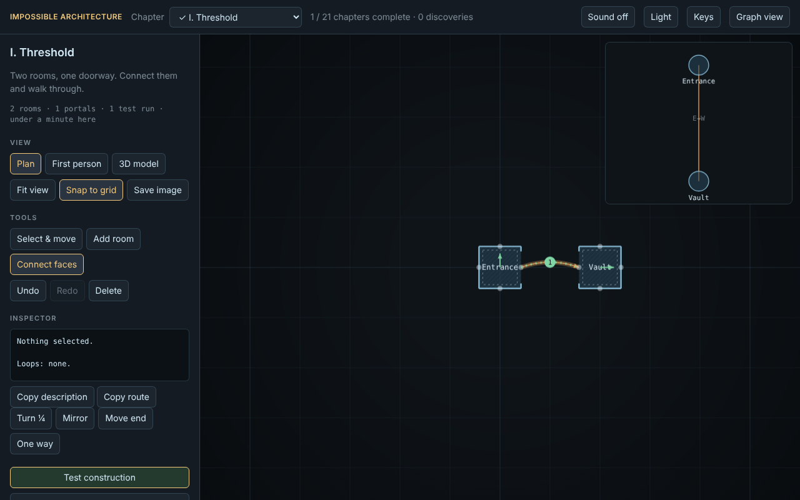
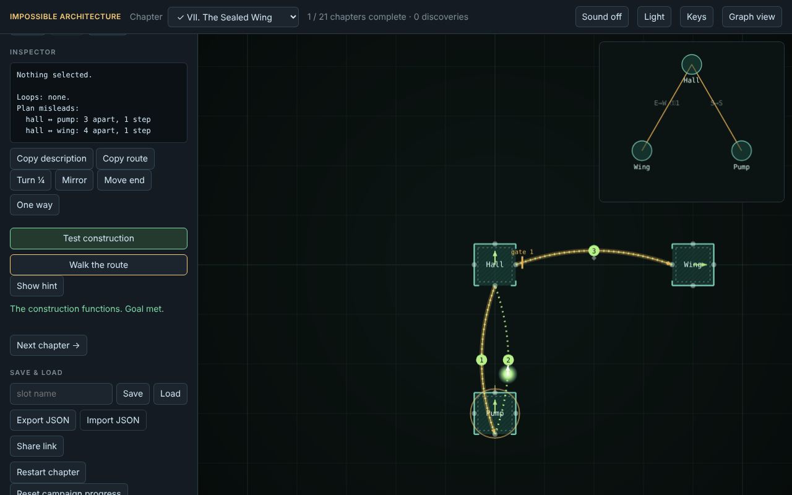
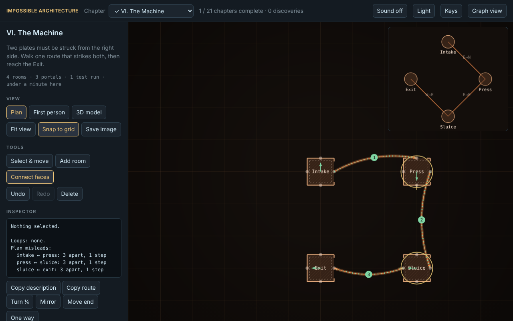
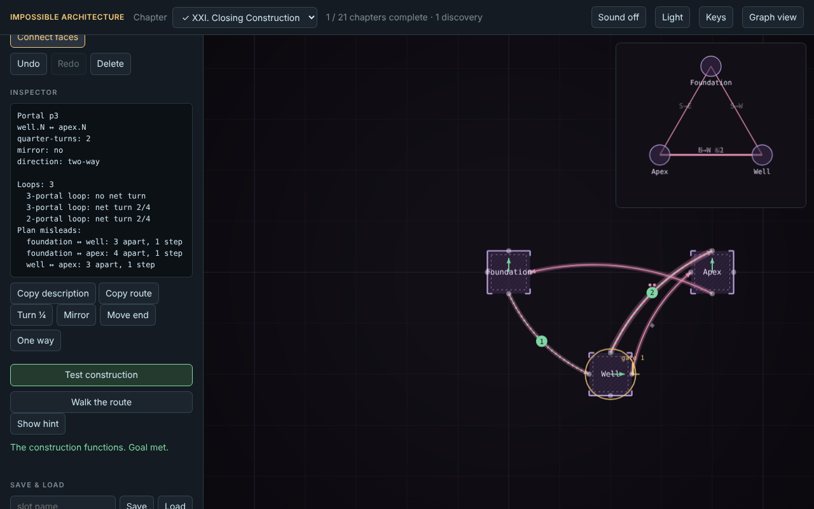

# Impossible Architecture

A construction game about space that is not fixed. You build rooms and connect
them with portals. A room's position on the plan never decides whether you can
reach it. Only the portals do.

## The central mechanic

Each portal can turn your heading by quarter-turns and reflect it. So a loop can
bring you back to a room facing a new direction, and two rooms drawn far apart
can be one step apart. The game checks every goal by searching the actual
connections, not by triggers, so a chapter is solved only when the building
works.

See [docs/SPATIAL.md](docs/SPATIAL.md) for the model.

## Running

Requires Node 18 or later. No dependencies.

```
npm start      # then open http://localhost:8080
npm test       # run the test suite
```

## Screenshots

Generated from the running game by `tools/capture-screenshots.mjs`, which
drives the application in headless Chromium.






## Scope

This is a playable slice: twenty-four chapters, pads and cargo, that must be carried and delivered with the right heading, delivery gates, menus with a pause screen and chapter list, a first-person view from inside any room, one-way passages, share links, field notes, a keyboard panel, a 3D model view you can orbit with a walker on the route, sound cues, optional discoveries, a sandbox, a graph
inspector with loop analysis, connection editing, save and load. It is not the full 3–5 hour campaign described in the original
brief. See [CHANGELOG.md](CHANGELOG.md) for what is and is not included.

## Documentation

- [Gameplay](docs/GAMEPLAY.md)
- [Spatial model](docs/SPATIAL.md) (plates, gates, loop analysis, sightlines)
- [Architecture](docs/ARCHITECTURE.md)
- [Testing](docs/TESTING.md)
- [Contributing](CONTRIBUTING.md)

## License

MIT. See [LICENSE](LICENSE).
